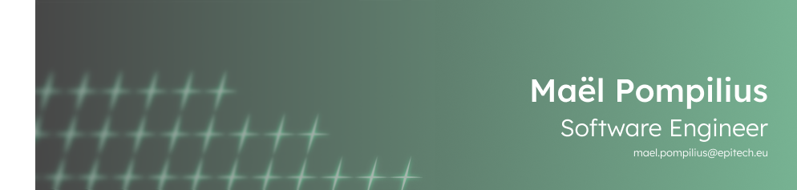
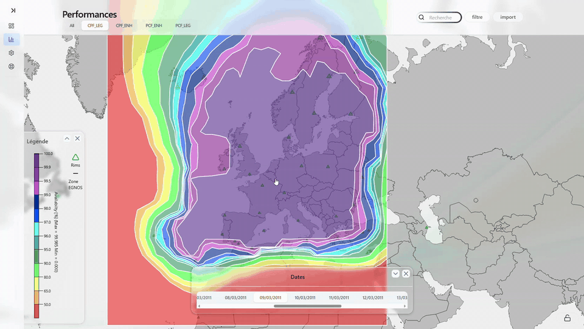
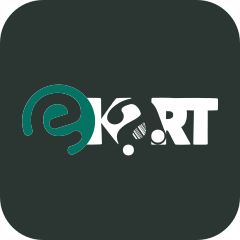
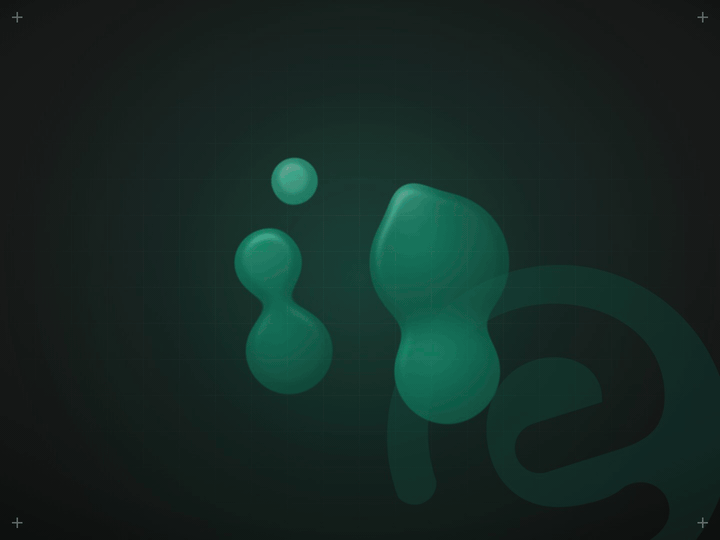
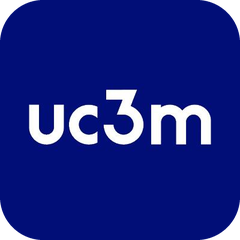

<div align="center">



<a href="https://git.io/typing-svg"></a>

<a href="https://www.linkedin.com/in/ma%C3%ABl-pompilius-7b8114232"></a>
<a href="mailto:mael.pompilius@epitech.eu"></a>
<a href="https://www.epitech.eu/"></a>

</div>

---

```console
mael@linux:~$ whoami
Maël Pompilius — Software Engineering student @ Epitech 🇫🇷

mael@linux:~$ cat focus.txt
→ Systems programming in C
→ Linux & containers
→ Web (React · PHP · Node)
→ DevOps (Docker · PHP · Node)

mael@linux:~$ echo $EDITOR
vim   # VS Code when nobody's looking
```

### ⚙️ Stack

| | |
|:--|:--|
| **Languages** |       |
| **Web** |   |
| **Systems** |     |
| **Tools** |    |

### 💼 Experience

<table>
  <tr>
    <td width="110" align="center">
      
    </td>
    <td>
      <b>Software Engineer</b> &nbsp;·&nbsp; <sub>Final-year internship</sub><br/>
      <b>Airbus Defence and Space</b> &nbsp;·&nbsp; <sub>Toulouse, France &nbsp;·&nbsp; Apr 2026 – Oct 2026</sub><br/><br/>
      Built tools to track the performance of algorithms on <b>EGNOS V3</b>, which improves GPS and Galileo accuracy for critical applications such as aviation.<br/>
      Processed and visualized data, including charts and dashboards.
    </td>
  </tr>
  <tr>
    <td colspan="2" align="center">
      
      <br/>
      <sub>🛰️ Availability maps and satellite monitoring across EGNOS coverage</sub>
    </td>
  </tr>
</table>

### 📂 Projects

<table>
  <tr>
    <td width="110" align="center">
      
    </td>
    <td>
      <b>E-Kart</b> &nbsp;·&nbsp; <sub>Epitech Innovative Project (EIP) · team of 6</sub><br/>
      <i>Scan · Pay · Go</i> — a mobile app that lets shoppers skip the checkout line: snap a product, the AI recognizes it (shape, text, color, barcode), it lands in your cart, and you pay in-app on the way out.<br/><br/>
      
      
      
      
      
    </td>
  </tr>
  <tr>
    <td colspan="2" align="center">
      
      <br/>
      <sub>📱 Mobile app &nbsp;·&nbsp; 🔌 REST API (JWT) &nbsp;·&nbsp; 🧠 AI recognition (YOLOv5 · K-Means · OCR) &nbsp;·&nbsp; 🖥️ Merchant back-office &nbsp;·&nbsp; 🐳 Dockerized server</sub>
    </td>
  </tr>
  <tr>
    <td width="110" align="center">
      
    </td>
    <td>
      <b>PlanyTrip</b> &nbsp;·&nbsp; <sub>Personal project</sub><br/>
      Plan a group trip where everyone fits the budget. Each friend enters their home city, budget and dates; the app gathers flights, trains and stays, computes the real cost for <i>each</i> guest, scores comfort, and the AI recommends the destination that works for the whole group — with the reasoning behind every number.<br/><br/>
      
      
      
      
      
      
    </td>
  </tr>
  <tr>
    <td colspan="2" align="center">
      
    </td>
  </tr>
  <tr>
    <td width="110" align="center">
      <a href="https://github.com/pmael/oye-tia"></a><br/><br/>
      <a href="https://www.uc3m.es"></a>
    </td>
    <td>
      <a href="https://github.com/pmael/oye-tia"><b>Oyé Tía</b></a> &nbsp;·&nbsp; <sub>Personal project</sub><br/>
      Website for a final-year film project (TFG) by Audiovisual students — BECA, UC3M (Universidad Carlos III de Madrid).<br/><br/>
      
      
    </td>
  </tr>
</table>
